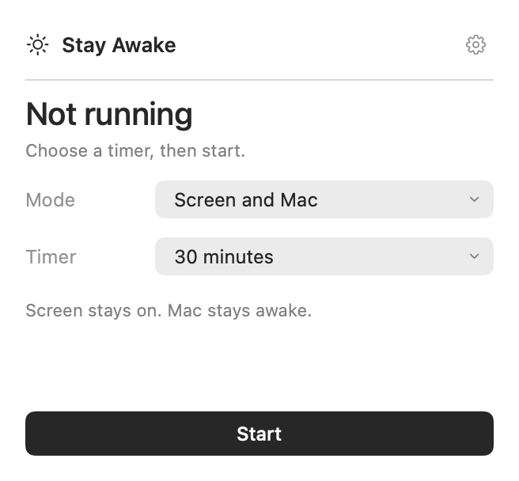
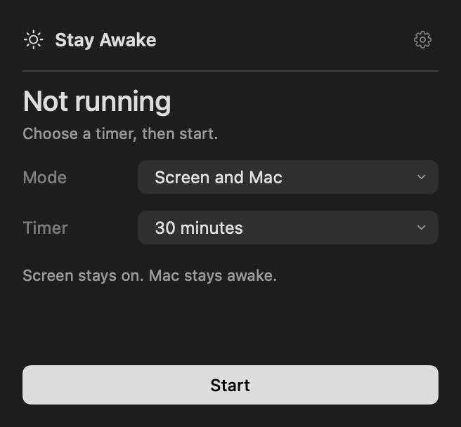
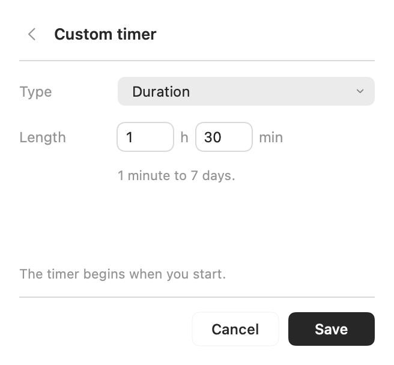
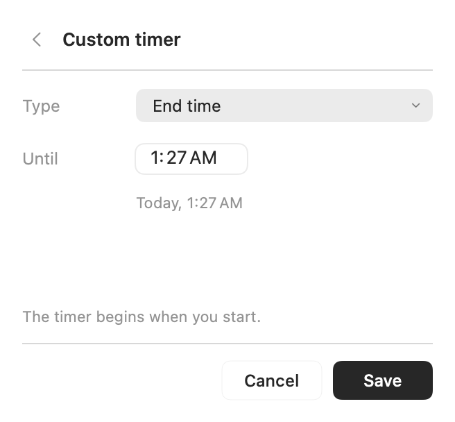

# Stay Awake

A small, native macOS menu bar app that keeps your Mac awake with a timer you control.

**macOS 14+ · Apple Silicon & Intel · SwiftUI + AppKit · MIT**

[Download v2.1.0 preview](https://github.com/jd-zhao/stay-awake/releases/tag/v2.1.0) · [Report a bug](https://github.com/jd-zhao/stay-awake/issues/new/choose)

> **Preview build:** the downloadable app is ad-hoc signed, not Developer ID signed or notarized by Apple. macOS may block it. You can build it locally from the source below. No notarized download is available yet.

<p>
  
  
</p>

## What it does

- **Screen and Mac:** keeps the display on and reports user activity during the session.
- **Mac only:** keeps tasks running while allowing the screen to sleep or lock.
- **Flexible timers:** until stopped, 30 minutes, 1 hour, 2 hours, a custom duration from 1 minute to 7 days, or a specific end time.
- **Native controls:** compact forms, keyboard editing, System / Light / Dark appearance, and optional menu bar countdown.
- **Local operation:** no account, network requests, analytics, ads, or third-party packages.

Manual lock and lid closure still work. Managed-device policies, low battery, thermal conditions, and explicit sleep can still lock or sleep the Mac. This app does not unlock a locked Mac.

## Install and use

1. Download the DMG or universal ZIP from [Releases](https://github.com/jd-zhao/stay-awake/releases/tag/v2.1.0).
2. Move **Stay Awake.app** to **Applications**.
3. Open it, click the sun in the menu bar, choose **Mode** and **Timer**, then click **Start**.
4. Click **Stop**, let the timer finish, or quit to release the session.

**Timer → Custom duration…** opens hours and minutes. **Timer → Until a time…** opens a native time field, with Today / Tomorrow shown underneath. Saving while running resets the session's deadline; Cancel keeps the existing settings.

<p>
  
  
</p>

The gear opens appearance, countdown, and optional login-start settings. The app starts in standby, including at login. Opening the app does not automatically begin a wake session.

## Build from source

Requires Xcode with a Swift 6 toolchain.

```sh
git clone https://github.com/jd-zhao/stay-awake.git
cd stay-awake
zsh scripts/build.sh
open "$HOME/Applications/Stay Awake.app"
```

The build script uses local ad-hoc signing and installs to `~/Applications` by default. Quit a running copy before replacing it. To build somewhere else and include both architectures:

```sh
zsh scripts/build.sh /tmp/stayawake-build --universal
zsh scripts/package.sh '/tmp/stayawake-build/Stay Awake.app'
```

Build output is under `dist/`. See [development and release notes](docs/DEVELOPMENT.md) for validation, reproducible UI images, and the Developer ID notarization workflow.

## Validation and limits

The self-check exercises real IOKit power assertions, release on stop/expiry, 15-second activity renewal, mode changes, custom-duration boundaries, end times, and settings persistence using an isolated temporary preference domain.

```sh
"$HOME/Applications/Stay Awake.app/Contents/MacOS/StayAwake" --self-check --wait-for-heartbeat
```

Native field alignment, keyboard selection/paste/Tab/Return, timer saving, and light/dark startup were checked locally on Apple Silicon. The Intel build is cross-compiled; physical Intel testing and extended unattended-idle testing remain outstanding. A passing self-check does not prove that every macOS lock policy will be suppressed.

## Privacy and license

Settings stay on your Mac. The app reads console lock/active-user state to pause screen protection while locked. It does not record or transmit that state, generate keyboard/mouse input, or request microphone, camera, screen recording, or Accessibility access. See [Privacy](docs/PRIVACY.md).

Released under the [MIT License](LICENSE). Bugs and questions can be submitted through [GitHub Issues](https://github.com/jd-zhao/stay-awake/issues).
