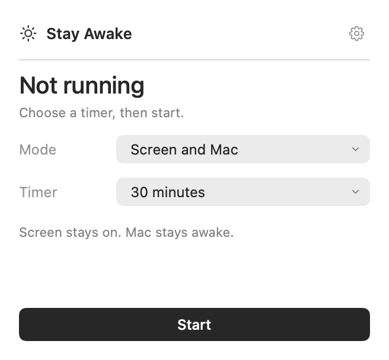
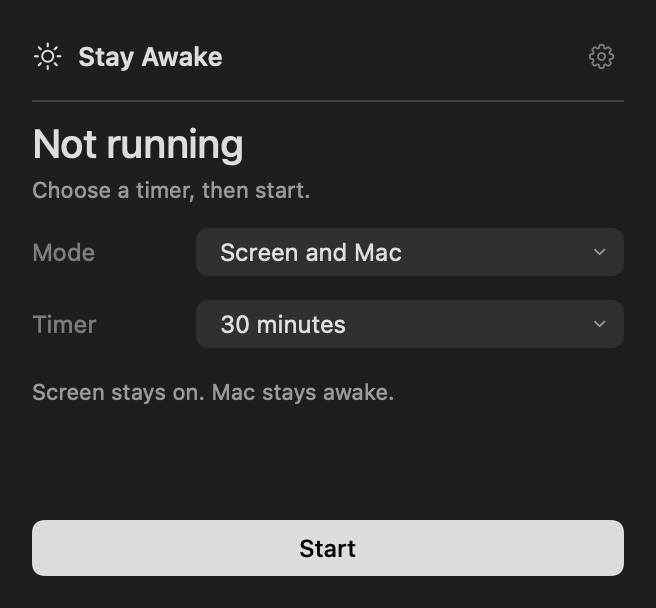
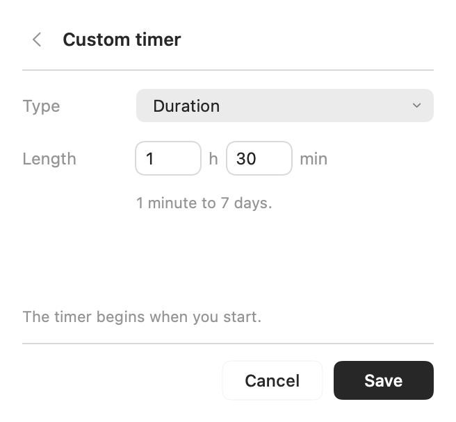
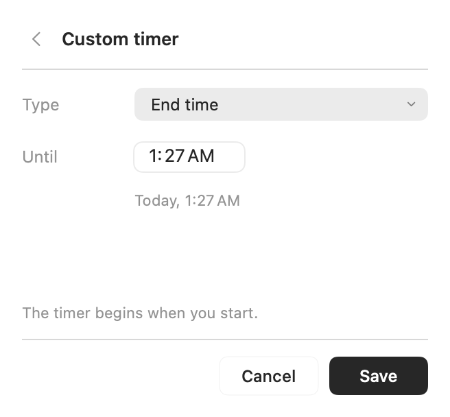

# Stay Awake

一个原生 macOS 菜单栏小工具，按你设定的时间保持电脑唤醒。

**macOS 14+ · Apple Silicon / Intel 通用版 · SwiftUI + AppKit · MIT**

[下载 v2.1.0 预览版](https://github.com/jd-zhao/stay-awake/releases/tag/v2.1.0) · [English](README.md) · [反馈问题](https://github.com/jd-zhao/stay-awake/issues/new/choose)

> **预览版说明：**目前下载包使用本机临时签名，尚未完成 Developer ID 签名和 Apple 公证，macOS 可能阻止打开。你也可以按下方步骤在本机构建源码。目前没有已公证的下载版本。

<p>
  
  
</p>

## 功能

- **Screen and Mac：**保持屏幕常亮、电脑运行，并在会话期间向系统报告用户活跃状态。
- **Mac only：**保持电脑运行，允许屏幕熄灭或锁屏。
- **自定义时间：**一直开启、30 分钟、1 小时、2 小时，或自定义 1 分钟到 7 天，也可指定结束时刻。
- **原生界面：**紧凑表单、系统深浅色、标准键盘编辑，以及可选的菜单栏倒计时。
- **本地运行：**无账号、无广告、不联网、不采集分析数据、无第三方依赖。

手动锁屏、合盖、主动休眠、低电量、温度保护和设备管理策略仍可能让 Mac 锁屏或休眠。本工具不会解锁已经锁定的电脑。

## 安装使用

1. 从 [Releases](https://github.com/jd-zhao/stay-awake/releases/tag/v2.1.0) 下载 DMG 或通用 ZIP。
2. 把 **Stay Awake.app** 放入 **Applications**。
3. 打开软件，点击菜单栏太阳图标，选择 **Mode** 和 **Timer**，再点击 **Start**。
4. 点击 **Stop**、等计时结束或退出软件，即可释放保活状态。

**Timer → Custom duration…** 可以输入小时和分钟；**Timer → Until a time…** 可以设置截止时间，说明会标明 Today / Tomorrow。运行中保存新时间会重新设置会话截止时间；Cancel 保留原设置。

<p>
  
  
</p>

齿轮设置里可以选择 System / Light / Dark、是否显示菜单栏倒计时、是否登录启动。普通启动和登录启动都会处于待机状态，需要自行开始会话。

## 从源码构建

需要带 Swift 6 工具链的 Xcode。

```sh
git clone https://github.com/jd-zhao/stay-awake.git
cd stay-awake
zsh scripts/build.sh
open "$HOME/Applications/Stay Awake.app"
```

默认生成本机架构的应用，临时签名后安装至 `~/Applications`。替换正在运行的版本前请先退出软件。构建通用版并生成 DMG：

```sh
zsh scripts/build.sh /tmp/stayawake-build --universal
zsh scripts/package.sh '/tmp/stayawake-build/Stay Awake.app'
```

产物位于 `dist/`。验证、界面图片生成、正式签名和公证流程见 [开发与发布说明](docs/DEVELOPMENT.md)。

## 验证与限制

自检覆盖真实 IOKit 断言读回和释放、15 秒活跃续期、模式切换、自定义时间边界、固定时刻到期和设置持久化，使用独立临时偏好域。

```sh
"$HOME/Applications/Stay Awake.app/Contents/MacOS/StayAwake" --self-check --wait-for-heartbeat
```

原生输入框对齐、全选/粘贴/Tab/回车、保存计时，以及深浅色启动已在 Apple Silicon Mac 上检查。Intel 版本已交叉编译；Intel 真机验证和长时间无人操作测试仍未完成。自检通过不代表能覆盖所有系统锁屏策略。

## 隐私与许可证

设置只保存在本机。应用读取控制台锁定和活跃用户状态，用来在锁屏时暂停屏幕保活，不会记录或上传这些状态，也不会模拟键盘/鼠标输入。不请求麦克风、相机、屏幕录制或辅助功能权限。详见 [隐私说明](docs/PRIVACY.md)。

采用 [MIT 许可证](LICENSE)。问题和建议可通过 [GitHub Issues](https://github.com/jd-zhao/stay-awake/issues) 提交。
